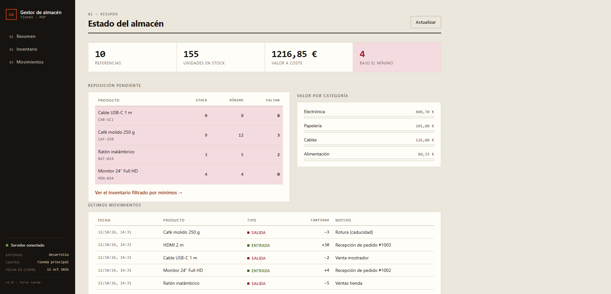
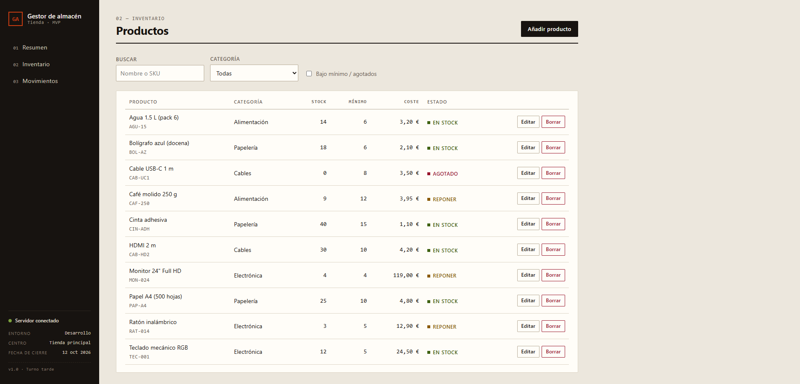
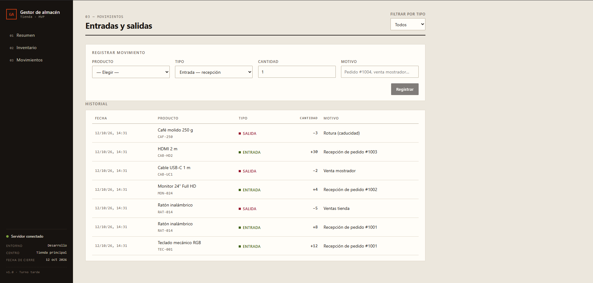

# Gestor de almacén de tienda


> **El problema:** una tienda pequeña controla su stock en una hoja de cálculo.
> Los números no cuadran, nadie sabe qué se vendió, y cuando hay que reponer
> ya es tarde.
>
> **La solución:** una aplicación web que centraliza productos, controla cada
> entrada y salida, y avisa de qué reponer de un vistazo.

**Gestor de almacén** es una aplicación completa, de base de datos a interfaz,
para llevar el inventario de una tienda. No es una demo de *todo clic*: tiene
reglas de negocio reales, arquitectura pensada para crecer y una suite de tests
que la protege mientras evoluciona.

---

## Índice

- [Capturas](#capturas)
- [Qué hace](#qué-hace)
- [Decisiones técnicas](#decisiones-técnicas)
- [Arquitectura](#arquitectura)
- [Calidad](#calidad)
- [Cómo ejecutarlo](#cómo-ejecutarlo)
- [Referencia de la API](#referencia-de-la-api)
- [Roadmap](#roadmap)

---

## Capturas

| Resumen | Inventario | Movimientos |
|:---:|:---:|:---:|
|  |  |  |


---

## Qué hace

### Controla el inventario, no una lista
Alta, edición y borrado de productos con **SKU único**, categoría, cantidad,
stock mínimo y precio de coste. Un producto no puede repetir SKU: la base de
datos lo impide y la API lo devuelve con un `409` claro.

### Registra cada movimiento
Cada entrada (recepción) y salida (venta o rotura) queda registrada con fecha,
motivo y producto. **El stock se ajusta en la misma transacción** que el
registro: o se hace todo, o no se hace nada.

### Nunca permite stock negativo
Intentar vender más de lo que hay devuelve un error y **no toca el stock**:

```json
{ "error": "Solo hay 13 unidades de «Ratón inalámbrico» en stock" }
```

Es una regla de negocio en el servidor, no un `disabled` en el formulario. Un
segundo cliente, un script o una recarga a mitad de petición no la saltan.

### Avisa de qué reponer
El resumen cruza cantidad y stock mínimo y lista lo que hay que pedir, con las
unidades que faltan. Se filtra el inventario con un clic.

### Mide el negocio
Valor total del inventario a coste, unidades en almacén y desglose por
categoría. Las cifras están en tipografía tabular para que las columnas se
comparen de un vistazo.

---

## Decisiones técnicas

_«Por qué» importa más que «con qué». Esto es lo que guió el proyecto._

### Arquitectura en capas (backend)
Una petición recorre `routes → services → repositories → db`. Las rutas solo
traducen HTTP, los servicios aplican las reglas de negocio y los repositorios
hablan SQL. **Ninguna capa conoce a la de más allá.**

_Efecto práctico:_ migrar de SQLite a PostgreSQL es cambiar un módulo
(`db/connection.js`) y traducir `schema.sql`. Services, rutas y frontend no se
enteran.

### SQL crudo con módulo nativo de Node
`node:sqlite` en vez de un ORM: sin dependencias que compilar, sin caja negra
y consultas que se leen tal cual. La contrapartida —escribir el SQL a mano— se
mitiga con los tests.

### Capa de datos aislada
La conexión a BD vive en un único archivo y se inyecta mediante variable de
entorno. Los tests corren sobre una base **en memoria** (`ALMACEN_DB=:memory:`):
rápidas y sin tocar los datos reales.

### Diseño con identidad propia
Una paleta de «papel y tinta» con un único color de señal, esquinas rectas y
filetes finos en lugar de tarjetas con sombra. **Todo el aspecto se controla
desde `styles/tokens.css`**: cambiar la paleta entera es editar un archivo.

### Frontend por features
Una carpeta por pantalla (`dashboard/`, `productos/`, `movimientos/`) sobre
capas compartidas (`api/`, `hooks/`, `components/`). Añadir una funcionalidad
es repetir un patrón, no reinventar la estructura.

---

## Arquitectura

```
.
├── backend/                  API REST (Node.js + Express + SQLite)
│   ├── src/
│   │   ├── server.js         Abre el puerto (lado de despliegue)
│   │   ├── app.js            Construye Express (testable sin puerto)
│   │   ├── db/
│   │   │   ├── connection.js Único punto de acceso a la BD
│   │   │   └── schema.sql    Esquema en SQL plano e idempotente
│   │   ├── repositories/     SQL puro: leer/escribir tablas
│   │   ├── services/         Reglas de negocio y transacciones
│   │   ├── routes/           HTTP fino: parsea y llama al servicio
│   │   └── lib/errors.js     AppError con código HTTP + asyncHandler
│   ├── tests/                Tests con el runner nativo de Node
│   └── data/almacen.db       BD (se crea sola; ignorada por git)
└── frontend/                 Interfaz (React + Vite, proxy /api → backend)
    └── src/
        ├── api/              Un archivo por recurso; client.js centraliza fetch
        ├── hooks/useApi.js   Estados de carga y error reutilizables
        ├── components/       Piezas compartidas (raíl, campos, estados)
        ├── features/         Una carpeta por pantalla
        └── styles/           tokens.css + base/layout/components
```

**Flujo de una petición:**

```
HTTP ──▶ routes/index.js ──▶ services/*.service.js ──▶ repositories/*.repo.js ──▶ SQLite
              ▲                       │
         traduce HTTP          reglas de negocio      SQL parametrizado
                                 (validación,
                              stock negativo…)
```

---

## Calidad

| Área | Qué se ha hecho |
|---|---|
| **Tests** | 16 tests de servicios con el runner nativo de Node. Cubren validaciones, SKU único, «el stock nunca baja de 0», filtros y códigos 404/409. |
| **Seguridad** | CORS restringido · SQL parametrizado (sin inyección) · salida escapada por React (sin XSS) · cabeceras `nosniff`, `X-Frame-Options`, `Referrer-Policy` · límite de cuerpo 200 kB · sin stack traces al cliente. |
| **Accesibilidad** | Enlace «saltar al contenido» · `role="alert"` y `role="status"` para lectores de pantalla · foco visible · objetivos táctiles de 44 px · `prefers-reduced-motion`. |
| **Rendimiento** | Lazy-loading por ruta · sin peticiones externas (funciona offline) · CSS y JS por debajo de 90 kB gzipped. |
| **Robustez** | `ErrorBoundary` (una pantalla que falla no tumba la app) · estados de carga y vacíos en cada vista · mensajes de error en español. |
| **SEO técnico** | `meta description` · Open Graph · `JSON-LD` · título dinámico por pantalla. |

### Estructura de carpetas del frontend

```
src/
├── api/            client.js · productos.js · movimientos.js · index.js
├── hooks/          useApi.js
├── components/     Rail · RailPie · EncabezadoPagina · Campo · Estado · Mensajes · ErrorBoundary · formato
├── features/       dashboard/ · productos/ · movimientos/
└── styles/         tokens.css · base.css · layout.css · components.css
```

---

## Cómo ejecutarlo

Requisitos: [Node.js](https://nodejs.org) **22.5 o superior** (usa el módulo nativo `node:sqlite`).

**Terminal 1 — backend** (puerto 3001):

```bash
cd backend
npm install
npm run seed     # solo la primera vez: crea datos de ejemplo
npm run dev
```

**Terminal 2 — frontend** (puerto 5173):

```bash
cd frontend
npm install
npm run dev
```

Abre <http://localhost:5173>.

> **Windows / PowerShell:** si `npm` da un error de «ejecución de scripts deshabilitada», usa `npm.cmd`.

### Tests

```bash
cd backend
npm test
```

---

## Referencia de la API

| Método | Ruta | Descripción |
|---|---|---|
| GET | `/api/dashboard` | Totales, bajo mínimo, últimos movimientos, valor por categoría |
| GET | `/api/productos?q=&categoria=&agotados=` | Listado con filtros |
| GET | `/api/productos/categorias` | Categorías distintas |
| GET | `/api/productos/:id` | Detalle |
| POST | `/api/productos` | Alta (SKU único) |
| PUT | `/api/productos/:id` | Edición |
| DELETE | `/api/productos/:id` | Baja (borra en cascada sus movimientos) |
| GET | `/api/movimientos?producto_id=&tipo=` | Historial |
| POST | `/api/movimientos` | `{ producto_id, tipo, cantidad, motivo }` |

**Errores:** `400` validación · `404` no existe · `409` conflicto (SKU duplicado, stock insuficiente) · `413` cuerpo demasiado grande. Todos en formato `{ "error": "mensaje" }`.

### Variables de entorno

| Variable | Descripción | Por defecto |
|---|---|---|
| `PORT` | Puerto del backend | `3001` |
| `ALMACEN_DB` | Ruta del SQLite | `backend/data/almacen.db` |
| `CORS_ORIGINS` | Orígenes permitidos, separados por coma | `http://localhost:5173` |
| `VITE_API_URL` | URL de la API para el frontend en producción | (mismo origen) |

### Despliegue

`npm run build` genera `frontend/dist`; sírvela con cualquier servidor estático
y ajusta `og:url` en `frontend/index.html` al dominio final.

---

## Roadmap

**Fase 2**
- Proveedores y pedidos de reposición.
- Varios almacenes o ubicaciones (pasillo/estante).
- Lectura de códigos de barras con la cámara del móvil.
- Usuarios con roles (admin / empleado) + JWT e histórico de «quién movió qué».
- Informes exportables a CSV/Excel con **Python** (pandas).
- Migración a PostgreSQL.

**Fase 3**
- Alertas automáticas (email / webhook) al bajar del mínimo.
- Predicción de reposición según rotación.
- Recuento cíclico: stock teórico vs real.

---

## Extender el proyecto

_En el código, añadir una funcionalidad (ejemplo: proveedores) es repetir un patrón:_

1. **Backend:** tabla nueva en `schema.sql` → `repositories/proveedores.repo.js` →
   `services/proveedores.service.js` → ruta en `routes/index.js`.
2. **Frontend:** `api/proveedores.js` → pantalla en `features/proveedores/` → enlace en `components/Rail.jsx`.
3. **Tests:** `tests/proveedores.service.test.js`.

---

## Licencia

MIT © 2026 · [Ricardo Pinheiro](https://github.com/Portu142)
